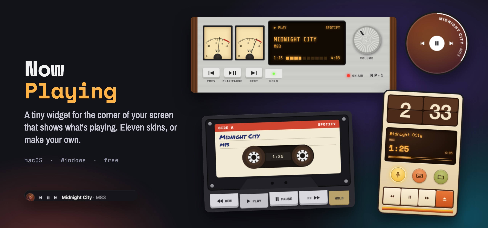
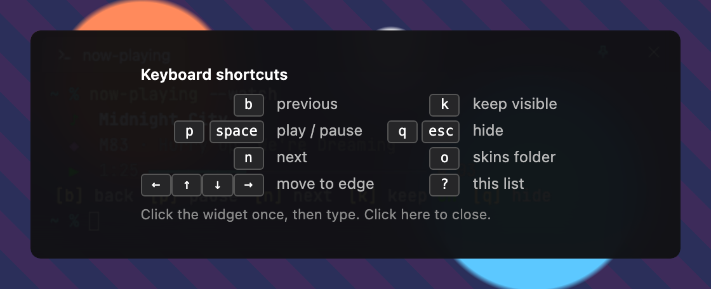

<p align="center">
  
</p>

<h1 align="center">Now Playing</h1>

<p align="center">
  <b>A small widget for the corner of your screen that shows what's playing.</b><br>
  Eleven built-in skins, or make your own with HTML and CSS. For macOS and Windows.
</p>

<p align="center">
  <a href="https://github.com/allcapsjoe/now-playing/releases/latest"><b>⬇&nbsp; Download</b></a>
  &nbsp;·&nbsp;
  <a href="#skins">Skins</a>
  &nbsp;·&nbsp;
  <a href="#using-it">How to use it</a>
  &nbsp;·&nbsp;
  <a href="#troubleshooting">Troubleshooting</a>
  &nbsp;·&nbsp;
  <a href="https://github.com/allcapsjoe/now-playing/issues/new/choose">Report a bug</a>
</p>

<p align="center">
  <a href="https://github.com/allcapsjoe/now-playing/releases/latest"></a>
  
  
  
</p>

---

Now Playing sits on top of your other windows and shows the song, artist,
album art and progress, with buttons to skip and pause. Glance at it instead
of switching to your music app.

- **Works with the player you already use.** Spotify and Apple Music on macOS.
  On Windows, anything that shows up in the Windows media controls, such as
  Spotify or music playing in your browser.
- **Stays out of the way.** No Dock or taskbar icon. Keep it on screen, or
  have it appear for a few seconds when the song changes.
- **Eleven skins.** A cassette deck, a hi-fi receiver, a flip clock, a
  see-through terminal and more. Switch any time.
- **Make your own skin.** A skin is a folder with a little HTML and CSS. No
  tools to install.
- **Private.** No account, no sign-in, no tracking. What you listen to is
  never saved or sent anywhere.

## Contents

- [Download](#download)
- [Install](#install)
- [Using it](#using-it)
- [Skins](#skins)
- [Make your own skin](#make-your-own-skin)
- [Troubleshooting](#troubleshooting)
- [Updating and uninstalling](#updating-and-uninstalling)
- [Privacy](#privacy)
- [Feedback and support](#feedback-and-support)
- [License](#license)

## Download

Get the latest version from
[**Releases**](https://github.com/allcapsjoe/now-playing/releases/latest),
under **Assets**:

| Your computer | Download the file ending in | Needs |
|---|---|---|
| **Mac** (Apple silicon or Intel) | `_universal.dmg` | macOS 11 Big Sur or later |
| **Windows**, most people | `_x64-setup.exe` | Windows 10 or 11, 64-bit |
| **Windows**, IT-managed installs | `_x64_en-US.msi` | Windows 10 or 11, 64-bit |

Not sure which Windows file? Choose the `setup.exe`.

## Install

The apps aren't signed with a paid developer certificate yet, so your computer
asks you to confirm the first time you open one. This is a one-time step.

### macOS

1. Open the `.dmg` and drag **Now Playing** into **Applications**.
2. Open Now Playing from Applications. macOS says it can't check the app for
   malicious software. Click **Done**.
3. Open **System Settings → Privacy & Security**, scroll down to
   **Security** and click **Open Anyway** next to Now Playing. Confirm with
   your password or Touch ID.
   - On macOS 14 Sonoma or earlier, you can instead right-click the app in
     Applications, choose **Open**, then click **Open** again.
4. When macOS asks whether Now Playing may control **Spotify** or **Music**,
   click **Allow**. This is how it reads what's playing. If you click Don't
   Allow by mistake, see [Troubleshooting](#nothing-shows-up-on-macos).

The widget appears in the bottom-right corner of your screen. Now Playing has
no Dock icon: look for its icon in the **menu bar** at the top of the screen.

### Windows

1. Run the `setup.exe`.
2. If you see **Windows protected your PC**, click **More info**, then
   **Run anyway**.
3. Follow the installer, then open Now Playing from the Start menu.

The widget appears in the bottom-right corner of your screen. Now Playing has
no taskbar button: look for its icon in the **system tray**,
next to the clock. If you don't see it, click the **^** arrow to show hidden
icons. You can drag it out of there so it's always visible.

## Using it

### Showing and hiding

Now Playing starts on screen and **kept visible**. There are two ways to use
it:

| | What it does | How to choose it |
|---|---|---|
| **Keep visible** (on) | Always on screen, on top of other windows | Press `k`, use the skin's pin button, or tick **Keep visible** in the menu |
| **Keep visible** (off) | Appears for five seconds when the song changes, then hides. It stays up while your pointer is over it. | The same, again |

To bring it back at any time, choose **Show / hide** from the menu, or open
the app again.

### Moving it

Drag it from any empty spot. It remembers where you put it. To snap it to an
edge of the screen, click it and press an arrow key.

### Keyboard shortcuts

Click the widget once, then type. The keys only work while the widget is
selected, so they never get in the way of other apps.

| Key | Does |
|---|---|
| `b` | Previous song |
| `p` or `Space` | Play / pause |
| `n` | Next song |
| `k` | Keep visible on / off |
| `q` or `Esc` | Hide |
| `o` | Open your skins folder |
| `←` `↑` `↓` `→` | Move to that edge of the screen |
| `?` | Show these shortcuts |

<p align="center">
  
</p>

### The menu

Click the icon in the menu bar (macOS), or right-click it in the system tray
(Windows).

| Item | Does |
|---|---|
| **Show / hide** | Shows or hides the widget |
| **Previous**, **Play / pause**, **Next** | Controls playback |
| **Skins** | Switches skin, opens your skins folder, or reloads skins after you change one |
| **Keep visible** | Keeps the widget on screen |
| **Keyboard shortcuts** | Shows the shortcuts on the widget |
| **Quit Now Playing** | Closes the app |

On Windows there are also two shortcuts on the tray icon itself: a **left
click** shows or hides the widget, and a **middle click** skips to the next
song.

### Supported players

| | Works with | How |
|---|---|---|
| **macOS** | Spotify and Apple Music | Asks the app directly. It only checks apps that are already open, so it never launches them. |
| **Windows** | Spotify, web browsers (for example YouTube Music in Edge or Chrome) and most other players | Reads the Windows media controls, the same ones the volume pop-up shows |

Album art is shown when the player provides it.

## Skins

Choose a skin from the menu → **Skins**. Each one is a different take on the
same widget.

<table>
<tr>
<td align="center" valign="top" width="50%"><br><b>Glass terminal</b> <sub>(default)</sub><br><sub>A see-through terminal window that blurs what's behind it.</sub></td>
<td align="center" valign="top" width="50%"><br><b>Cassette deck</b><br><sub>A tape with a handwritten label, spinning reels and chunky keys.</sub></td>
</tr>
<tr>
<td align="center" valign="top" width="50%"><br><b>Hi-fi receiver</b><br><sub>Brushed metal, wood side panels, VU meters and an amber display.</sub></td>
<td align="center" valign="top" width="50%"><br><b>Reel-to-reel</b><br><sub>A studio tape deck. The reels turn and the tape winds as the song plays.</sub></td>
</tr>
<tr>
<td align="center" valign="top" width="50%"><br><b>brUno</b><br><sub>A cream 1960s radio panel with a speaker grille and round keys.</sub></td>
<td align="center" valign="top" width="50%"><br><b>Pocket</b><br><sub>A 2000s pocket music player with an LCD and a click wheel.</sub></td>
</tr>
<tr>
<td align="center" valign="top" width="50%"><br><b>CRT</b><br><sub>A green phosphor monitor with scanlines, flicker and a blinking cursor.</sub></td>
<td align="center" valign="top" width="50%"><br><b>Cyberpunk</b><br><sub>Neon cyan and magenta on a black grid.</sub></td>
</tr>
<tr>
<td align="center" valign="top" width="50%"><br><b>Flip</b><br><sub>A tall 70s desk gadget with a flip clock and an amber display.</sub></td>
<td align="center" valign="top" width="50%"><br><b>Orb</b><br><sub>Round and tinted from the album art, with the title circling the edge.</sub><br><br><br><b>Slim</b><br><sub>One small line, with a record tinted from the album art.</sub></td>
</tr>
</table>

## Make your own skin

A skin is a folder with three small files. You only need a text editor.

```text
my-skin/
  skin.json   its name and size
  skin.html   what's in it
  skin.css    how it looks
```

1. Choose **Skins → Open skins folder** from the menu.
2. Make a folder there, for example `my-skin`, and add the files. A minimal
   skin:

   **skin.json**
   ```json
   { "name": "My skin", "width": 320, "height": 64 }
   ```

   **skin.html**
   ```html
   <div class="box">
     <b data-np="title"></b>
     <span data-np="artist"></span>
     <button data-np-action="toggle">⏯</button>
   </div>
   ```

   **skin.css**
   ```css
   .box { position: fixed; inset: 0; display: flex; gap: 8px; align-items: center;
          padding: 0 14px; background: #222; color: #fff; border-radius: 12px;
          font: 14px system-ui; }
   ```

3. Choose **Skins → Reload skins**, then pick **My skin (yours)**.

The `data-np` attributes are where the app fills in the song details, and
`data-np-action` makes a button do something. [**Making skins**](docs/skins.md)
lists them all, with album art, progress bars, the time of day, fonts and
animations.

Skins can't run scripts or go online, so a skin you download from someone else
can't do anything except draw the widget.

## Troubleshooting

<details>
<summary id="nothing-shows-up-on-macos"><b>Nothing shows up on macOS</b></summary>

- Make sure Spotify or Music is open and playing. Now Playing doesn't open
  them for you.
- Check that Now Playing is allowed to control them: **System Settings →
  Privacy & Security → Automation → Now Playing**, and turn on **Spotify** and
  **Music**.
- If Now Playing isn't listed there, quit it, then run this in Terminal and
  open Now Playing again so macOS asks once more:
  ```sh
  tccutil reset AppleEvents com.allcapsjoe.nowplaying
  ```
</details>

<details>
<summary><b>Nothing shows up on Windows</b></summary>

- Play something, then press a volume key. If the Windows volume pop-up shows
  the song, Now Playing can see it too. If it doesn't, that player doesn't
  report to Windows, so Now Playing can't show it.
</details>

<details>
<summary><b>I can't find the widget</b></summary>

- Choose **Show / hide** from the menu, or open the app again. Either brings
  it back.
- If **Keep visible** is off, the widget hides itself a few seconds after a
  song change. Turn it on to keep the widget up.
- If it was on a screen that's no longer connected, quit and reopen Now
  Playing. It moves to the bottom-right corner of your main screen.
</details>

<details>
<summary><b>The keys don't do anything</b></summary>

Click the widget once first. The keys only work while it's selected, so that
they don't interfere with typing in other apps.
</details>

<details>
<summary><b>My skin doesn't appear in the list, or looks wrong</b></summary>

- Choose **Skins → Reload skins** after adding or changing files.
- The folder name must be lowercase letters, numbers, `-` or `_`.
- `skin.json` needs `name`, `width` and `height`, and must be valid JSON
  (watch for trailing commas).
</details>

<details>
<summary><b>Does it start when I log in?</b></summary>

Not yet. To start it automatically, add it yourself:

- **macOS:** **System Settings → General → Login Items**, click **+** and
  choose Now Playing.
- **Windows:** press `Win`+`R`, type `shell:startup` and press Enter, then put
  a shortcut to Now Playing in that folder.
</details>

## Updating and uninstalling

**Updating:** Now Playing doesn't update itself yet. Download the newest
version from [Releases](https://github.com/allcapsjoe/now-playing/releases)
and install it over the old one. Your skin, position and settings are kept.
To hear about new versions, click **Watch → Custom → Releases** at the top of
this page.

**Uninstalling:**

- **macOS:** quit Now Playing from the menu bar and drag it from Applications
  to the Trash.
- **Windows:** **Settings → Apps → Installed apps → Now Playing → Uninstall**.

Your settings and skins stay in this folder, so delete it too if you want them
gone:

| | Folder |
|---|---|
| **macOS** | `~/Library/Application Support/com.allcapsjoe.nowplaying` |
| **Windows** | `%APPDATA%\com.allcapsjoe.nowplaying` |

## Privacy

- Song details stay in memory while the app runs, and are never saved or
  sent anywhere.
- There's no account, no analytics and no crash reporting.
- The only things saved on your computer are your chosen skin, whether it's
  kept visible, where you put the widget, and any skins you add.
- Skins can't go online. The one exception is Spotify's artwork server, so
  skins can show Spotify album art.

## Feedback and support

- **Found a bug?** [Report it](https://github.com/allcapsjoe/now-playing/issues/new/choose).
  Say which computer and player you use, and what you expected to happen.
- **Have an idea?** [Suggest it](https://github.com/allcapsjoe/now-playing/issues/new/choose).
- **Security problem?** Please report it privately, as [SECURITY.md](SECURITY.md)
  explains.

Please don't post anything private in issues, like your listening history.

## License

Now Playing is free to download and use. The source code isn't public. See
[LICENSE](LICENSE) for the terms, and [third-party notices](THIRD-PARTY-NOTICES.md)
for the open-source software and fonts it includes. Skins you make are yours.

Now Playing is independent and isn't affiliated with or endorsed by Spotify,
Apple or any other media provider.
