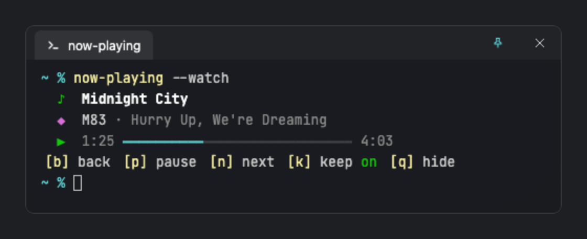
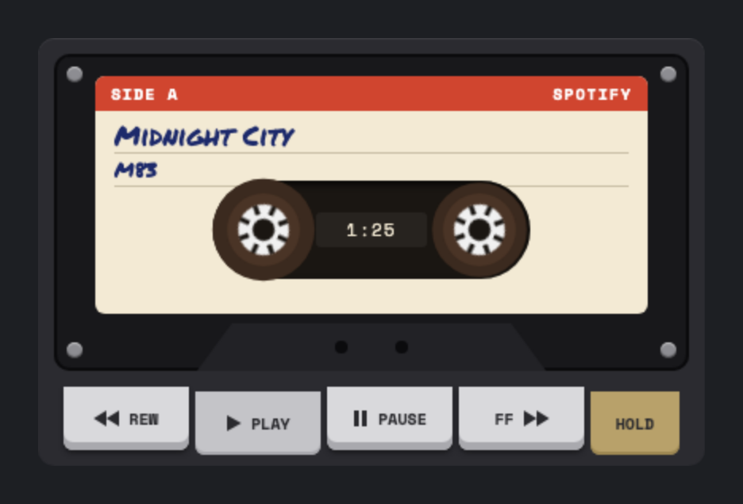
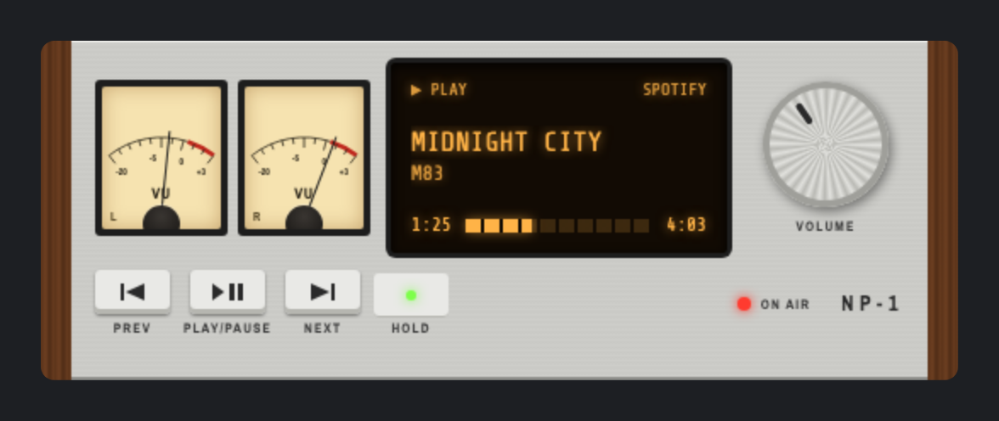
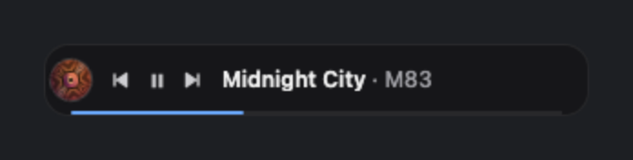
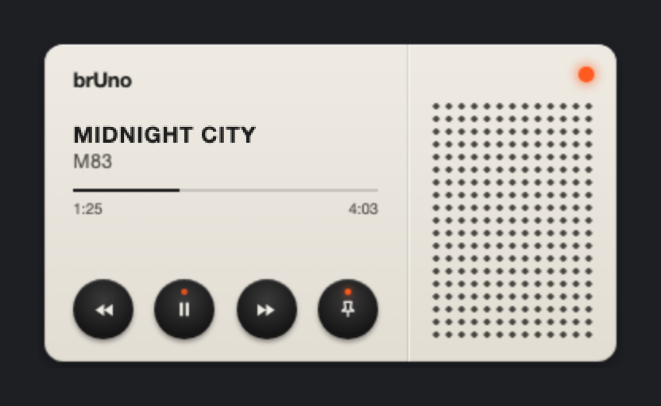
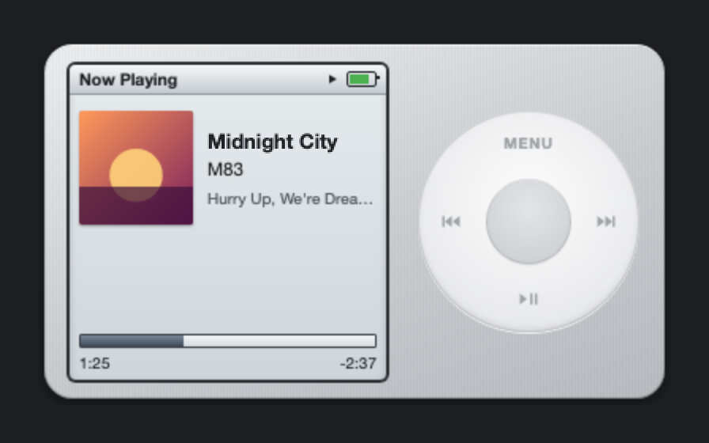
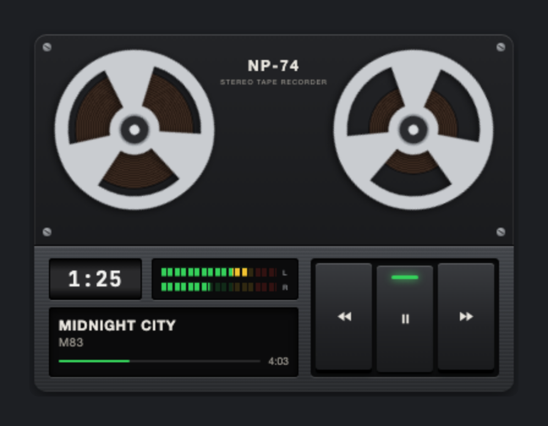
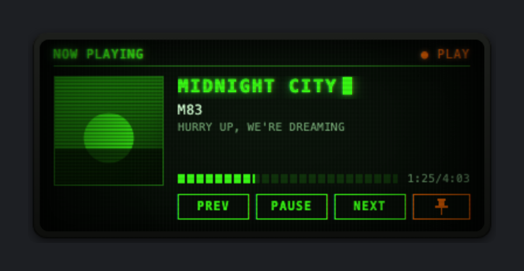
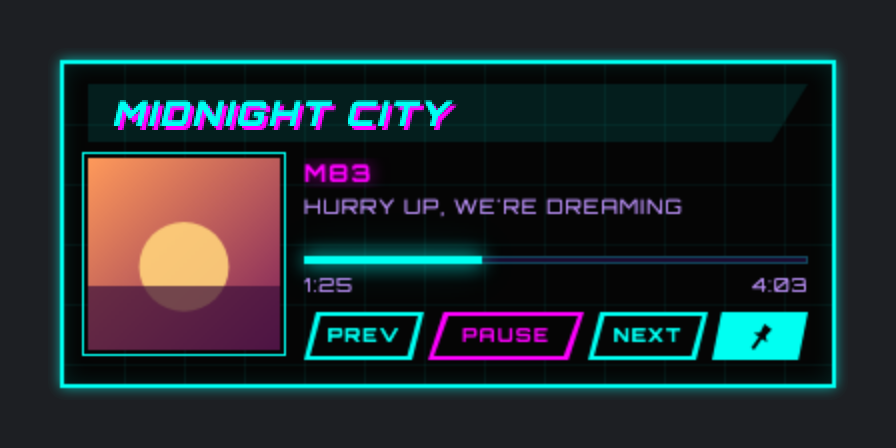
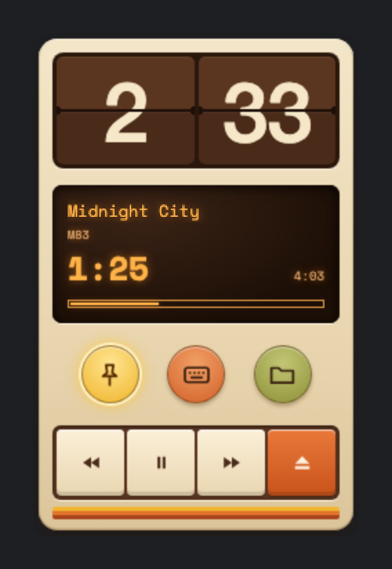

# Now Playing

A small, skinnable now-playing widget for **macOS and Windows**. Glance at the
corner of your screen to see what's playing, without switching to your music
app.

It reads your computer's own media controls. There is no account, no login,
no cloud service and no telemetry.

- **macOS:** works with Spotify and Apple Music. It only talks to them when
  they're already running, so it never launches them.
- **Windows:** works with Spotify, browsers and most players, through the
  Windows media controls.

## Download

Get the latest version from [**Releases**](https://github.com/allcapsjoe/now-playing/releases/latest):

- **macOS** (Apple silicon and Intel): `Now Playing_<version>_universal.dmg`
- **Windows** (10 and 11): `Now Playing_<version>_x64-setup.exe`, or the `.msi`

### Opening it the first time

The apps aren't signed yet, so your computer will warn you the first time.

**macOS:** open the `.dmg` and drag Now Playing to Applications. The first time
you open it, macOS says it can't check the app. Click **Done**, then open
**System Settings → Privacy & Security**, scroll down and click **Open Anyway**
next to Now Playing. On older macOS versions, right-click the app and choose
**Open** instead.

macOS then asks whether Now Playing may control Spotify or Music. Allow it, or
the widget can't see what's playing. You can change this later in **System
Settings → Privacy & Security → Automation**.

**Windows:** if SmartScreen says "Windows protected your PC", click **More
info**, then **Run anyway**.

## Using it

- It starts visible and **kept visible**. Turn off **Keep visible** (or the
  skin's pin button, or press `k`) and it appears for five seconds when the
  track changes, staying up while your pointer is over it.
- Drag it from any empty spot. It remembers where you put it.
- Click it once, then use the keys: `b` previous, `p` or Space play/pause, `n`
  next, `k` keep visible, `q` or Esc hide, `o` skins folder, arrows move it to
  that edge of the screen, `?` shows this list.
- The tray / menu-bar icon has show/hide, playback controls, skins, keep
  visible and quit.

## Skins

Choose a skin from the tray / menu-bar icon → **Skins**. Eleven are built in:

<table>
<tr>
<td align="center" valign="top" width="50%"> <b>Glass terminal</b> A see-through terminal window, using the OS blur.</td>
<td align="center" valign="top" width="50%"> <b>Cassette deck</b> A tape with a handwritten label, spinning reels and chunky keys.</td>
</tr>
<tr>
<td align="center" valign="top" width="50%"> <b>Hi-fi receiver</b> Brushed metal, wood side panels, VU meters and an amber display.</td>
<td align="center" valign="top" width="50%"> <b>Slim</b> One small line, with a record tinted from the album art.</td>
</tr>
<tr>
<td align="center" valign="top" width="50%"> <b>Orb</b> Round, tinted from the album art, with the title circling the edge.</td>
<td align="center" valign="top" width="50%"> <b>brUno</b> A cream 1960s radio panel with a speaker grille and round keys.</td>
</tr>
<tr>
<td align="center" valign="top" width="50%"> <b>Pocket</b> A 2000s pocket music player with an LCD and a click wheel.</td>
<td align="center" valign="top" width="50%"> <b>Reel-to-reel</b> A studio tape deck: the reels turn and the tape winds as the song plays.</td>
</tr>
<tr>
<td align="center" valign="top" width="50%"> <b>CRT</b> A green phosphor monitor with scanlines, flicker and a blinking cursor.</td>
<td align="center" valign="top" width="50%"> <b>Cyberpunk</b> Neon cyan and magenta on a black grid.</td>
</tr>
<tr>
<td align="center" valign="top" width="50%"> <b>Flip</b> A tall 70s desk gadget with a flip clock and an amber display.</td>
</tr>
</table>

### Make your own

A skin is a folder of plain HTML and CSS. Choose **Skins → Open skins folder**,
drop in a folder, then choose **Skins → Reload skins**. See
[Making skins](docs/skins.md) for the format.

## Privacy

Track details stay in memory and are never saved or sent anywhere. Skins can't
make network requests, except for album art from Spotify's artwork server.

## Feedback

Found a bug or have an idea? [Open an issue](https://github.com/allcapsjoe/now-playing/issues).
Please don't include anything private, like your listening history. For
security problems, see [SECURITY.md](SECURITY.md).

## License

Now Playing is free to download and use; the source code isn't public. See
[LICENSE](LICENSE) and [third-party notices](THIRD-PARTY-NOTICES.md).

Now Playing is independent and isn't affiliated with or endorsed by Spotify,
Apple or any other media provider.
